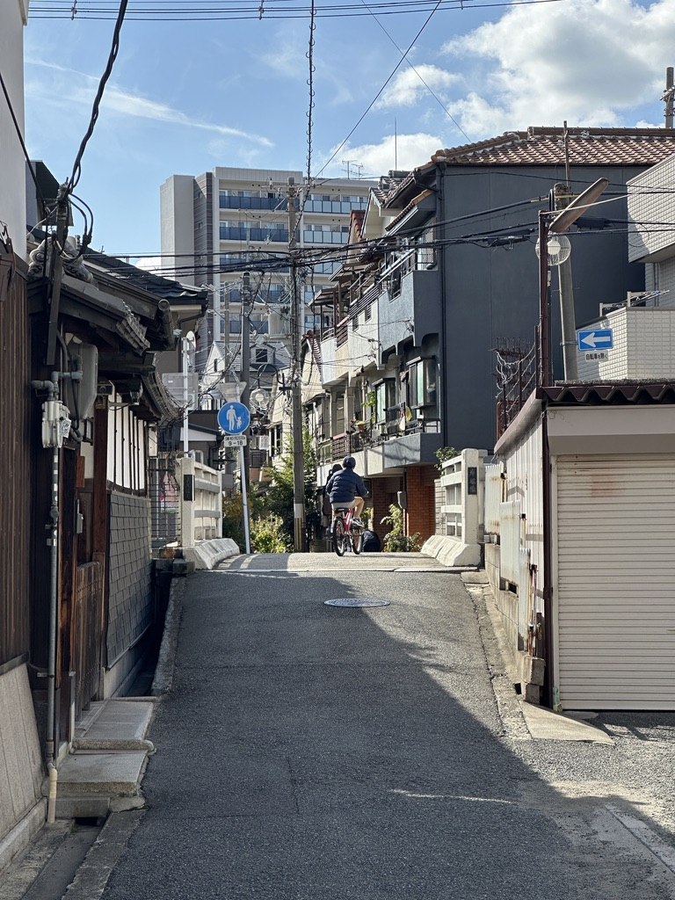
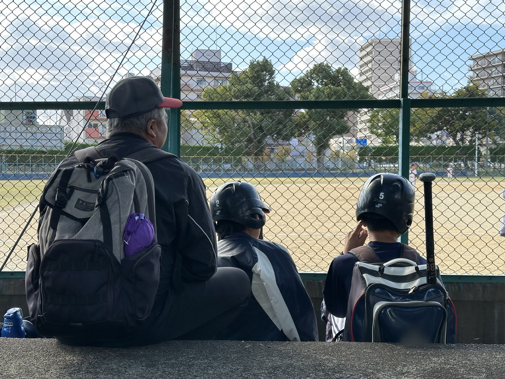

最近在拜讀《沙山早月》
看到了這一句
**「旅行就是這樣，和一些此生都不會見面的人們見一面。」**
感觸太深了
<!--more-->
不知道從什麼時候開始 我不再迷信所謂「目的地」
旅行不僅僅是只有幾個景點 二三餐館 打卡即畢
對我來說 置身其中的每時每刻 都是我的「目的地」
在難波廣場前 在JR上 在我所途經的每一條路上
看著來來往往的人
我們都是 「八十億分之一」

我原本一輩子都不會遇見他們的
而旅行給我了這個機會 與世界建立聯繫

所以在住吉大社 我願意 沈默地坐下來看旁邊的小男孩騎車
看他搖搖晃晃過橋 慢慢遠去 消失在我的視線中
在野球場邊 我願意 和那些看著自己孩子表現的家長 坐在水泥地上
看球飛上天空 振臂高呼 為他們贏得勝利而高興

在我忙碌的旅行中 我是很願意拿出一些時刻
和原本應該毫無相識機會的人 建立記憶
我拍攝此刻 我留下印記 我永遠回憶
我收藏了他們 收藏了這個瞬間 而他們對此一無所知

坦誠而言 我是浪跡世界的浪人
我感恩旅行 感謝它恩賜與我和世界所有「人」建立關係的機會

**「我」和「世界」**

途經我身邊的人 好像操著不同的語言
是日本人中國人英國人美國人德國人新加坡人等等等等

在我的家鄉 很少見到來自遠方的旅行者
我曾很樂於通過一些語音的細節 去猜測他們來自何方
像是德國人愛把句尾的d發成t 而英國人喜歡吞t音

不過此刻 站在難波廣場的中央
我不再想去分辨風中傳來的 是何方的語調
因為在這一秒裡 我在向前走
我才覺得我真的存活在這個世界上
我沒有被世界所隔離在外
我是這個千姿多彩 萬般盛宴世界中的一名

**「公民」**

我行，我知。
A. Khronos
